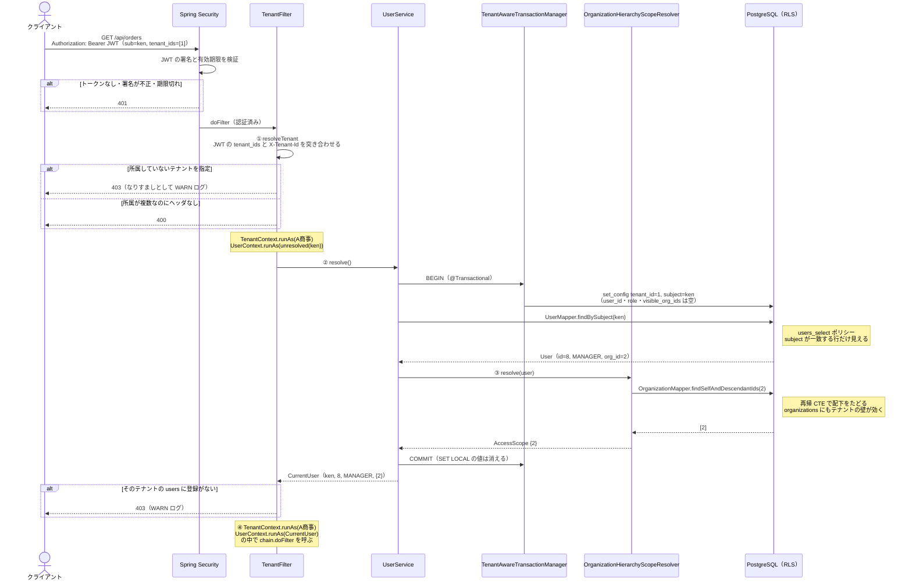
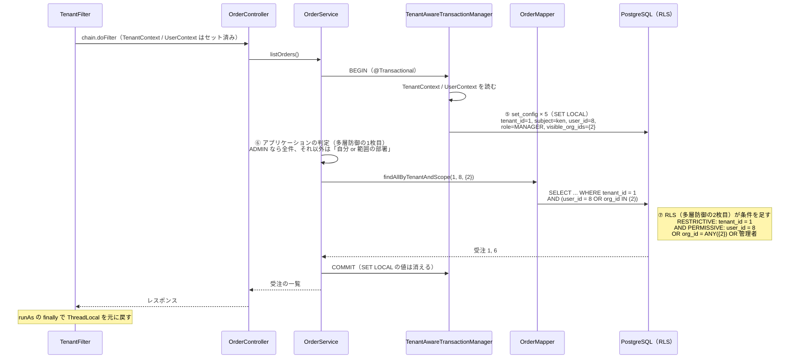
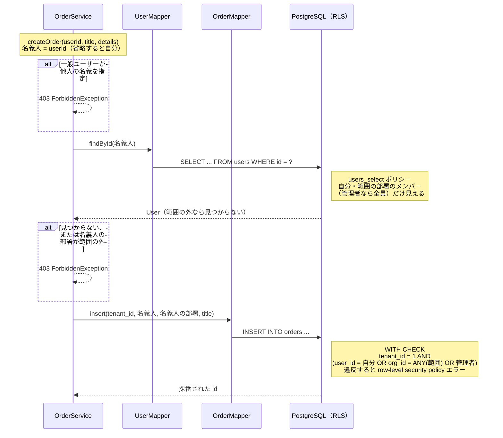

# 認可の処理の流れ

このサンプルで「誰が、どのデータを見られるか」が、どのクラスのどの処理で決まるのかを、シーケンス図で説明します。

- 背景と設計の考え方: [STORY.md](STORY.md)
- 組織階層の見える範囲を「判断はアプリケーション、強制は DB」にした理由: [ADR.md](ADR.md)
- 動かし方と API の例: [README.md](../README.md)

例として、**第一営業部の部長 ken** が `GET /api/orders` を呼んだ場合をたどります。

## 全体像

認可は、次の3段階で行われます。

| 段階 | 何を決めるか | 主なクラス |
|---|---|---|
| フェーズ1: 入口 | どのテナントの、誰として動くか。その人が見てよい部署はどこか | `TenantFilter`、`UserService`、`OrganizationHierarchyScopeResolver` |
| フェーズ2: 業務処理 | その人に見せてよい行はどれか（アプリケーションと DB の二重チェック） | `OrderService`、`TenantAwareTransactionManager`、RLS ポリシー |
| フェーズ3: 書き込み | その人がその名義・その部署でデータを作ってよいか | `OrderService`、RLS ポリシー（`WITH CHECK`） |

登場する主なクラスと、その役割は次のとおりです。

| クラス | 役割 |
|---|---|
| Spring Security（`SecurityConfig` の `JwtDecoder`） | JWT が改ざんされていないか、期限が切れていないかを検証する |
| `TenantFilter` | 入口の門番。テナント → ユーザー → 見てよい部署の順に決めて、`TenantContext` / `UserContext`（ThreadLocal）に入れる |
| `UserService`（`CurrentUserResolver` の実装） | JWT の `sub` から users の行を引き、ユーザーID・ロール・見てよい部署をまとめた `CurrentUser` を作る |
| `OrganizationHierarchyScopeResolver`（`AccessScopeResolver` の実装） | 組織階層をたどって「見てよい部署」（`AccessScope`）を算出する。将来 OpenFGA などに置き換える差し込み口 |
| `TenantAwareTransactionManager` | トランザクション開始（BEGIN）の直後に、ThreadLocal の値を `SET LOCAL` で DB に渡す |
| `OrderService` | ロールに応じた SQL を選ぶ（多層防御の1枚目）。書き込み時の名義・部署のチェック |
| PostgreSQL の RLS ポリシー | 渡された値で、最後に行を絞る（多層防御の2枚目） |

## フェーズ1: 入口で「誰として動くか」を決める

ポイント:

- **① テナントの根拠は JWT のクレームだけ**です。`X-Tenant-Id` ヘッダは「所属テナントの中からどれを使うか」を選ぶためだけに使い、そのまま信用しません
- **② ユーザーの解決も RLS に守られています**。この時点で DB に届いているのは `tenant_id` と `subject` だけなので、users テーブルからは自分の行しか引けません
- **③ が差し替えポイント**です。兼務・代理・期間限定の権限を足したり、OpenFGA に置き換えたりするときに変わるのは、`AccessScopeResolver` の実装だけです
- **④ 以降の処理はすべて「A商事の ken」として動きます**。`runAs` は `finally` で ThreadLocal を元に戻すので、スレッドプールで次のリクエストに値が残りません

## フェーズ2: 業務処理で、アプリケーションと DB が二重にチェックする

ポイント:

- **⑤ DB に値を渡すのは `TenantAwareTransactionManager` の1か所だけ**です。BEGIN の直後に同じ接続で `SET LOCAL` するので、そのトランザクションのすべての SQL に効き、COMMIT / ROLLBACK で消えます（コネクションプールに残りません）
- **⑥ と ⑦ は同じ条件の二重チェック**です。`/api/orders/leaky` のように ⑥ で WHERE を書き忘れた SQL でも、⑦ の RLS が同じ条件を足すので、結果は同じ「受注 1, 6」になります
- **⑦ の RLS は組織階層をたどりません**。アプリケーションが算出した `visible_org_ids` と比べるだけなので、ポリシーは単純なまま、行ごとに再帰が走ることもありません
- 他社や範囲の外の行を id で指定した場合（IDOR）も、⑦ で行が見えないので 0 件になり、アプリケーションは 404 を返します

## フェーズ3: 書き込み（代理作成）のチェック

部長 ken が、部員 bob（第一営業部）または範囲の外の carol（第二営業部）の名義で受注を作る場合です。

ポイント:

- **アプリケーションのチェック**: 一般ユーザーは他人の名義を指定できません。管理職は、範囲の部署のメンバーの名義だけ指定できます
- **名義人の検索にも RLS が効きます**。範囲の外のユーザーは `findById` で見つからないので、アプリケーションのチェックをすり抜けても名義人を特定できません
- **受注の部署（`org_id`）には、名義人のその時点の所属部署を記録します**。名義人が後で異動しても、受注は元の部署のデータのままです
- **DB の `WITH CHECK`** が最後の砦です。アプリケーションのチェックをすり抜けて Mapper を直接呼んでも、範囲の外の部署や他人の名義の受注は作れません。明細（`order_details`）も「親の受注が見えるか」を `WITH CHECK` で確かめます

## エラーの返し方

| ステータス | いつ返すか | どこで判定するか |
|---|---|---|
| 401 | トークンなし・署名が不正・期限切れ | Spring Security |
| 400 | 所属が複数なのに `X-Tenant-Id` がない、ヘッダが数値でない | `TenantFilter` |
| 403 | 所属していないテナントを指定した、そのテナントの users に登録がない | `TenantFilter` |
| 403 | 一般ユーザーが他人の名義で作ろうとした、範囲の外のメンバーの名義で作ろうとした、一般ユーザーがユーザー一覧を見ようとした | `OrderService`、`UserService` |
| 404 | 他社・他人・範囲の外の**既存の行**を id で指定した | RLS で行が見えず、アプリケーションが「存在しない」として返す |

403 を返すのは、**自分の権限についての情報**だけです。他人の既存の行に 403 を返すと「その id の行は存在する」と相手に教えてしまうので、すべて 404 にしています。

## この流れを確認しているテスト

| テスト | 確認していること |
|---|---|
| `TenantFilterWebTest` | フェーズ1（401 / 400 / 403、テナントごとのロール、`/api/me` の見てよい部署） |
| `OrganizationHierarchyScopeResolverTest` | フェーズ1の ③（見てよい部署の算出、階層をたどる SQL にもテナントの壁が効くこと） |
| `OrderRlsIntegrationTest` | フェーズ2のテナントの壁（管理者でも他社は見えない、トランザクション途中の切り替え禁止） |
| `OrderRoleAccessTest` | フェーズ2・3の一般ユーザーと管理者の違い |
| `OrgScopeAccessTest` | フェーズ2・3の部長・事業部長の範囲、異動しても過去の受注が元の部署のデータのままであること |
