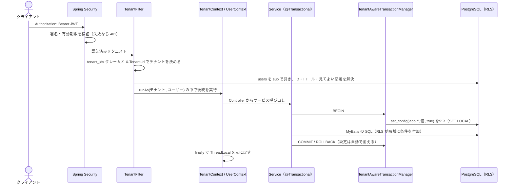

# アーキテクチャ概要：多層防御とリクエストの流れ

このリポジトリは「WHERE 句を書き忘れても、id だけで取りに来られても、他社のデータは返らない」を体験するための Spring Boot 4.1 / MyBatis / PostgreSQL 17 のサンプルです。守りの中心はアプリのコードではなく **PostgreSQL の Row Level Security（RLS）** で、アプリの役割は「今のリクエストが、どのテナントの誰か」を正しく決めて DB に届けることです。

## 守りの2段構え

RLS のポリシーは、どのテーブルでも次の2段で組まれています（詳細は [スキーマと RLS ポリシー](../database/schema-and-rls-policies.md)）。

| 段 | ポリシーの種類 | 守るもの | 条件の例（`orders`） |
|---|---|---|---|
| テナントの壁 | `AS RESTRICTIVE` | 他テナントの行は絶対に見せない・書かせない | `tenant_id = current_tenant_id()` |
| テナントの中の権限 | PERMISSIVE（既定） | テナントの中で「誰のデータまで」扱えるか | `user_id = 自分 OR org_id = ANY(見てよい部署) OR 管理者` |

PostgreSQL では RESTRICTIVE 同士が AND、PERMISSIVE 同士が OR で結合され、最終条件は「RESTRICTIVE を全部 AND」かつ「PERMISSIVE のどれか」になります。テナントの壁を RESTRICTIVE にしているので、あとから誰かが条件の緩い PERMISSIVE ポリシーを足しても、他テナントの行は見えないままです。

テナントの中のロールは3種類です（`Role`）。

- `GENERAL`（一般）: 自分のデータだけ
- `MANAGER`（部長・事業部長）: 自分のデータに加えて、組織階層で算出した「見てよい部署」のデータ
- `ADMIN`（管理者）: テナント内の全員のデータ

## 「判断はアプリ、強制は DB」

組織階層による見える範囲は、RLS のポリシーで階層をたどるのではなく、アプリが「見てよい部署の一覧」を算出して DB に渡し、RLS はその一覧と `org_id` を比べるだけにしています。兼務・代理・期間限定の権限が増えても、変わるのはアプリ側の算出（`AccessScopeResolver` の実装）だけで、ポリシーは変わりません。設計判断の経緯は `docs/ADR.md`、仕組みは [組織階層による見える範囲](../authorization/org-hierarchy-scope.md) を参照してください。

## 多層防御：アプリの WHERE と RLS の二重チェック

RLS があってもアプリ側の WHERE 句は消していません。`OrderService` はロールに応じて Mapper を選び、一般・管理職なら `tenant_id` と「自分または見てよい部署」、管理者なら `tenant_id` で絞ります。そのうえで RLS が同じ条件を DB で足します。

- アプリの WHERE が正しければ、RLS は何も削らない（結果は同じ）
- アプリが WHERE を書き忘れても（`/api/orders/leaky`）、RLS が同じ条件を足すので結果は同じ
- `id` だけで他人・他社の行を指定されても（IDOR）、RLS で行が見えず 0 件になり、アプリは 404 を返す

一方、`BYPASSRLS` ロールで動くバッチや管理機能には RLS が効かないため、アプリ側の条件が唯一の守りになります。これがアプリの WHERE を残す理由の1つです。

## 1リクエストの流れ

1. **認証**: `SecurityConfig` が全リクエストに認証を要求し、`JwtDecoder` が JWT の署名と `exp` を検証します。
2. **テナントとユーザーの確定**: `AuthorizationFilter` の後ろに置かれた `TenantFilter` が、JWT のクレーム `tenant_ids` を根拠にテナントを決め、そのテナントの `users` を `sub` で引いてユーザー ID・ロール・見てよい部署を決めます。詳細は [テナントとユーザーの確定](../request-lifecycle/tenant-and-user-resolution.md)。
3. **スレッドへの格納**: 決まった値は `TenantContext` / `UserContext`（ThreadLocal）に `runAs` で入れ、後続の処理が終わると必ず元に戻します。
4. **DB への受け渡し**: `@Transactional` なサービスメソッドでトランザクションが始まると、`TenantAwareTransactionManager#prepareTransactionalConnection` が同じ接続に `app.tenant_id` / `app.subject` / `app.user_id` / `app.role` / `app.visible_org_ids` を `SET LOCAL` 相当で設定します。詳細は [DB へのコンテキスト受け渡し](../request-lifecycle/db-session-context.md)。
5. **RLS による強制**: MyBatis の SQL はそのまま実行され、RLS ポリシーが設定値を読んで行を絞ります。
6. **後始末**: COMMIT / ROLLBACK で `SET LOCAL` の値は消えるので、コネクションプールの次の利用者に値が残りません。

DB に値を渡す場所は `TenantAwareTransactionManager` の1か所だけで、サービス層や Mapper はテナントを意識せずに SQL を書けます。

## fail-closed の設計

どこかで値が欠けたときに「漏れる」のではなく「見えない」側に倒れるよう、各段が作られています。

- テナントが未設定のトランザクションでは `set_config` を発行しないので、ポリシーは NULL と比較して 0 件になる（INSERT はエラー）
- ユーザーが未解決なら `app.user_id` などは空文字になり、ヘルパー関数が NULL・`false`・空配列に変換するので、やはり何も見えない
- `@Transactional` の外で Mapper を呼ぶと設定が入らず 0 件になる（漏れはしないが気付きにくいので、テストで検知する）

## パッケージ構成

| パッケージ | 責務 |
|---|---|
| `tenant` | 認証設定、`TenantFilter`、`TenantId` / `CurrentUser` / `Role` / `AccessScope`、ThreadLocal（`TenantContext` / `UserContext`）、`TenantAwareTransactionManager` |
| `user` | `UserService`（`CurrentUserResolver` の実装）、`AccessScopeResolver` インターフェース、`/api/me`・`/api/users` |
| `org` | `OrganizationHierarchyScopeResolver`（組織階層から見てよい部署を算出する自前の実装） |
| `order` | 受注・明細の Controller / Service / Mapper。正しい SQL と「よくある危ない SQL」を併置 |
| `common` | `ForbiddenException` と、404 / 403 を `ProblemDetail` で返す `ApiExceptionHandler` |
| `db/init` | 接続ロール、スキーマと RLS ポリシー、デモデータ |

API とエラーの返し方は [受注・ユーザー API と Mapper](../domain/orders-and-users-api.md)、動かし方は [ローカルでの動かし方とデモ](../operations/local-development.md)、テストの読み方は [テスト：越境できないことの確認](../testing/rls-test-suite.md) にまとめています。
