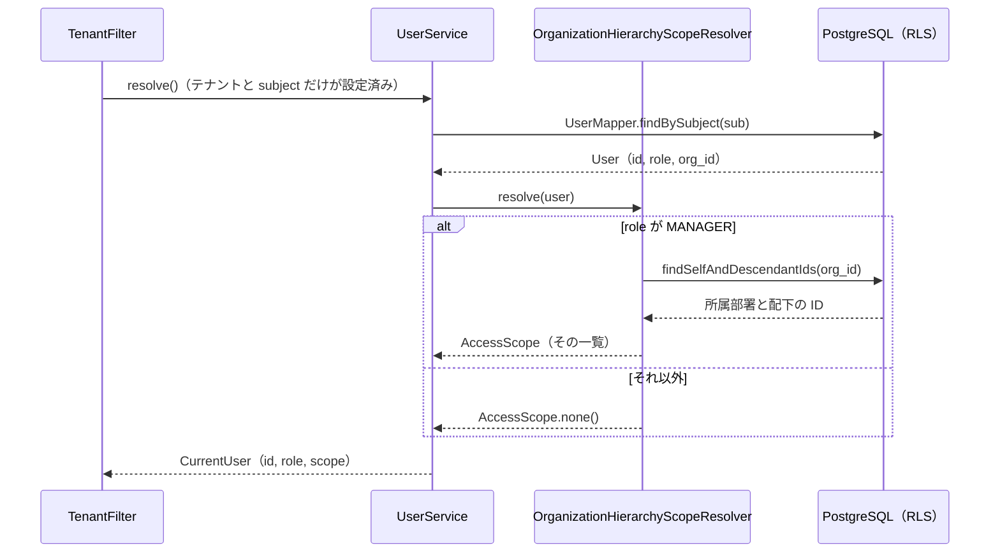

# 組織階層による見える範囲（AccessScope と AccessScopeResolver）

テナントの中で、部長は自分の部、事業部長は事業部と配下の部のデータを扱えます。この「見える範囲」は **判断はアプリケーション、強制は DB** で実現しています。

- **判断**: アプリケーションの `AccessScopeResolver` が、ユーザーの所属部署と組織階層から「見てよい部署の一覧」（`AccessScope`）を算出する
- **受け渡し**: `TenantAwareTransactionManager` がその一覧を `app.visible_org_ids` として `SET LOCAL` で DB に渡す
- **強制**: RLS は `org_id = ANY(current_app_visible_org_ids())` で「渡された一覧に入っているか」だけを見る

## なぜこの形にしたか

`docs/ADR.md` の決定の要点です。

- 今の4パターン（一般・部長・事業部長・管理者）だけなら RLS のポリシーで階層をたどることもできるが、兼務・代理・期間限定・例外共有といった要件が今後増えると、ポリシーが複雑になり、変更のたびに DDL とデプロイが必要になる
- 認可をすべてアプリケーションに移すと、テナントの中で WHERE の書き忘れがそのまま事故になり、RLS を入れた理由の半分を失う
- そこで、判断をアプリケーションに置きつつ、強制は DB に残した。ポリシーは「渡された一覧に入っているか」から変わらないので、要件が増えても変わるのはアプリケーションの算出ロジックだけになる

ポイントは、認可を **受注1件ずつではなく部署の単位** で行うことです。部署の数は受注の数よりはるかに少ないので、一覧の絞り込みは `org_id = ANY(...)` という単純でインデックスの効く条件になります。

## 部品

| 部品 | パッケージ | 役割 |
|---|---|---|
| `AccessScope` | `tenant` | 「自分のデータ以外に見てよい部署」の不変な集合。`asSettingValue()` で PostgreSQL の配列リテラル（例 `{1,2,3}`、昇順）に変換する |
| `AccessScopeResolver` | `user` | `AccessScope resolve(User user)` だけを持つ差し込み口。将来 OpenFGA の `ListObjects` を使う実装に置き換えることを想定している |
| `OrganizationHierarchyScopeResolver` | `org` | 自前の実装（ADR の候補 A）。`MANAGER` なら所属部署とその配下を返し、それ以外は空 |
| `OrganizationMapper#findSelfAndDescendantIds` | `org` | 指定した部署とその配下を、`parent_id` をたどる再帰 CTE で求める |
| `UserService#resolve` | `user` | `users` の行を引いたあと、`AccessScopeResolver` を呼んで `CurrentUser` に `scope` を詰める |

### ロールごとの範囲

`OrganizationHierarchyScopeResolver` は、ロールが `MANAGER` でなければ `AccessScope.none()` を返します。

- `GENERAL`: 範囲は空。RLS の `user_id = 自分` だけが効く
- `MANAGER`: 自分の所属部署とその配下のすべて
- `ADMIN`: 範囲は空。管理者の「全部見える」は `app.role = 'ADMIN'` で表すので、部署の一覧には含めない

デモデータ（A商事）では次のようになります。

| ユーザー | 所属 | ロール | 見てよい部署 |
|---|---|---|---|
| ken | 第一営業部(2) | MANAGER（部長） | `{2}` |
| mika | 営業事業部(1) | MANAGER（事業部長） | `{1,2,3}` |
| bob | 第一営業部(2) | GENERAL | `{}` |
| alice | 管理本部(4) | ADMIN | `{}`（ロールで全件） |

`/api/me` の `visibleOrganizationIds` で、算出結果を確認できます。

### 再帰 CTE とテナントの壁

`findSelfAndDescendantIds` は `WITH RECURSIVE` で起点の部署から子をたどるだけで、SQL に `tenant_id` 条件はありません。それでも `organizations` には RESTRICTIVE なテナントの壁がかかっているので、再帰の途中で他テナントの部署に出ることはなく、他テナントの部署を起点にすると何も返りません。

この再帰はリクエスト（ユーザーの解決）ごとに1回だけ実行され、RLS のポリシーは階層をたどらないので、行ごとに再帰が走ることもありません。そのため `ltree` のような専用の型や閉包テーブルは使わず、`organizations.parent_id` だけで階層を表しています。

## 解決のタイミング

範囲の算出は、ユーザーの解決と同じトランザクションの中で行われます。

この時点の DB には `app.tenant_id` と `app.subject` しか届いていませんが、`organizations_select` ポリシーはテナント内の全員に組織図の参照を許しているので、階層をたどれます。組織の追加・変更・削除は管理者だけです。

範囲はキャッシュせず、リクエストごとに算出しています。異動や権限の変更は次のリクエストから反映されます（キャッシュの要否は ADR の未決事項）。

## 範囲が効く場所

算出した範囲は、DB とアプリケーションの両方で使われます。

- **RLS**: `orders` の `owner_or_scope_or_admin` と `users` の `users_select` が `org_id = ANY(current_app_visible_org_ids())` を含む。明細は親の受注が見えるかで決まるので、範囲は明細にも及ぶ
- **アプリケーション**: `OrderService#listOrders` は範囲を `findAllByTenantAndScope` に渡し、`createOrder` は他人名義の代理作成で名義人の部署が範囲に入っているかを確かめる。`UserService#listUsers` は管理職に範囲の部署のメンバーだけを返す

管理職は範囲の中で参照も更新もできます（代理作成を含む）。ポリシーを SELECT と書き込みで分けていないので、`WITH CHECK` によって範囲の外の部署の受注は作れず、範囲の外へ付け替えることもできません。API 側の挙動は [受注・ユーザー API と Mapper](../domain/orders-and-users-api.md)、ポリシーの全体は [スキーマと RLS ポリシー](../database/schema-and-rls-policies.md) を参照してください。

## 異動しても受注は元の部署に残る

`orders.org_id` は **受注を作った時点の名義人の部署** です。`createOrder` は名義人の今の `org_id` を記録し、その後名義人が異動しても受注の `org_id` は変わりません。そのため、異動後も元の部署の部長が過去の受注を見られ、本人も `user_id` が自分なので引き続き見られます。一方、ユーザー一覧では異動した人は元の部長の範囲から外れます。

## 拡張点

兼務・代理・期間限定の権限が必要になったときに変えるのは、`AccessScopeResolver` の実装だけです。RLS のポリシーと Mapper は変わりません。ADR では、要件が具体化した時点で OpenFGA（`ListObjects` で「見てよい部署の一覧」を取る）への置き換えを PoC で評価するとしています。

注意点として、判断が DB の外にあるため、psql やバッチなどアプリケーションを通らない経路では、その経路で渡す範囲を別に決める必要があります。また `app.visible_org_ids` を SQL インジェクションで書き換えられると、テナント内の任意の部署のデータが見えます（RESTRICTIVE があるので他テナントには届きません）。

## 確認しているテスト

- `OrganizationHierarchyScopeResolverTest`: 本番と同じ経路（`UserService.resolve` → `OrganizationHierarchyScopeResolver`）で解決した結果がテスト用 `Actor` と一致すること、部長・事業部長・一般・管理者の範囲、再帰 CTE にもテナントの壁が効くこと
- `OrgScopeAccessTest`: 範囲ごとの見え方、範囲の外への IDOR、代理作成、`WITH CHECK`、異動後の受注の扱い

詳しくは [テスト：越境できないことの確認](../testing/rls-test-suite.md) を参照してください。
