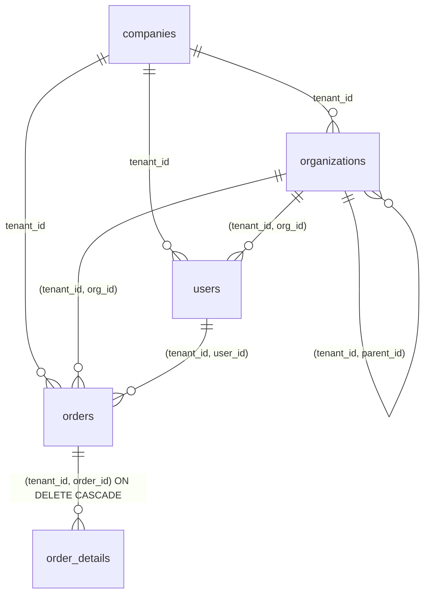

# スキーマと RLS ポリシー

守りの本体は `db/init/02_schema.sql` です。アプリはここで定義した関数が読む `app.*` 設定を届けるだけで、「どの行が見えるか」は DB が決めます。初期化スクリプトは `compose.yaml` で `/docker-entrypoint-initdb.d` にマウントされ、DB が空のときだけアルファベット順に実行されます（`01_roles.sql` → `02_schema.sql` → `03_data.sql`）。

## 接続ロール

| ロール | 作られる場所 | 用途 | RLS |
|---|---|---|---|
| `owner` | `compose.yaml` の `POSTGRES_USER` | テーブル所有者・スーパーユーザー。DDL とデータ投入専用で、アプリからは使わない | 素通り（スーパーユーザー） |
| `app_user` | `01_roles.sql` | アプリが普段使うロール（`application.yml`） | **効く** |
| `app_bypass` | `01_roles.sql`（`BYPASSRLS`） | バッチ・運用管理用。`bypass` プロファイルで「RLS がない状態」を再現するデモにも使う | 素通り |

スーパーユーザーと `BYPASSRLS` を持つロールは、`FORCE ROW LEVEL SECURITY` を付けても RLS を素通りします。そのためアプリは必ず `app_user` で接続します。Spring Boot の Docker Compose 連携は `POSTGRES_USER`（スーパーユーザー）で接続してしまうので、このサンプルでは使っていません。

## テーブルとデータモデル

| テーブル | 種類 | 主な列 | 備考 |
|---|---|---|---|
| `companies` | 共有マスタ（テナント自体） | `id`, `name` | RLS なし。`app_user` には SELECT だけ付与 |
| `organizations` | テナント所有 | `tenant_id`, `parent_id`, `name` | 事業部 → 部 の階層を `parent_id` で表す |
| `users` | テナント所有 | `tenant_id`, `org_id`, `subject`, `role` | `(tenant_id, subject)` が一意。同じ人でもテナントごとに別の行とロールを持つ |
| `orders` | テナント所有 | `tenant_id`, `user_id`, `org_id`, `title` | `org_id` は作成時点の名義人の部署 |
| `order_details` | テナント所有（子） | `tenant_id`, `order_id`, `item`, `quantity`, `unit_price` | 子テーブルにも `tenant_id` を持たせて RLS をかける |

### 複合外部キーでテナントをまたぐ関連を作らせない

テナント所有テーブル間の外部キーは、すべて `(tenant_id, 親の id)` の複合です。参照先には `UNIQUE (tenant_id, id)` を置いています。これにより「A商事の受注なのに B工業のユーザー名義」「親と違うテナントの明細」「別テナントの部署の配下」といった行は、RLS とは関係なく制約違反で作れません。

子テーブル `order_details` に `tenant_id` を持たせているのは、親を経由せずに子テーブルを直接 SELECT されたときにも RLS を効かせるためです。

インデックスは `(tenant_id, ...)` を先頭にしています（`orders_tenant_user_idx`、`orders_tenant_org_idx`、`order_details_tenant_order_idx`、`organizations_tenant_parent_idx`）。アプリ側の WHERE に `tenant_id` を残しておくと、これらを使った実行計画になりやすくなります。

## 「今の接続は誰か」を返す関数

ポリシーは `current_setting` を直接読まず、次のヘルパー関数を通します。

| 関数 | 読む設定 | 戻り値 | 未設定のとき |
|---|---|---|---|
| `current_tenant_id()` | `app.tenant_id` | `bigint` | NULL |
| `current_app_subject()` | `app.subject` | `text` | NULL |
| `current_app_user_id()` | `app.user_id` | `bigint` | NULL |
| `current_app_is_admin()` | `app.role` | `boolean` | `false` |
| `current_app_visible_org_ids()` | `app.visible_org_ids` | `bigint[]` | 空配列 `{}` |

すべて `current_setting(name, true)` を `NULLIF(..., '')` で包んでいます。一度でも `SET LOCAL` したセッションでは、トランザクション終了後に `current_setting` が NULL ではなく空文字を返し、`''::bigint` はエラーになるためです。NULL との比較は常に偽なので、未設定なら 0 件になります（fail-closed）。値をどう設定するかは [DB へのコンテキスト受け渡し](../request-lifecycle/db-session-context.md) を参照してください。

## RLS の有効化

テナント所有の4テーブルすべてに `ENABLE ROW LEVEL SECURITY` と `FORCE ROW LEVEL SECURITY` を付けています。`FORCE` がないと、テーブル所有者は RLS を素通りします。

README には、RLS が有効になっていないテナント所有テーブル（`tenant_id` 列を持つのに `relrowsecurity` か `relforcerowsecurity` が偽のもの）を `pg_class` から検出するクエリが載っています。テーブルを増やすときのチェックに使えます。

## ポリシーの構成

どのテーブルも、RESTRICTIVE なテナントの壁と、PERMISSIVE なテナント内の権限の2段です。

- RESTRICTIVE はすべて AND で効き、PERMISSIVE は OR で効く。最終条件は `(RESTRICTIVE を全部 AND) AND (PERMISSIVE のどれか1つ)`
- RESTRICTIVE だけでは何も許可されない（PERMISSIVE が1つもなければ 0 件）
- `USING` は SELECT / UPDATE / DELETE で見える行を、`WITH CHECK` は INSERT / UPDATE で書き込める行を絞る

| テーブル | RESTRICTIVE | PERMISSIVE（参照） | PERMISSIVE（書き込み） |
|---|---|---|---|
| `organizations` | `tenant_isolation` | `organizations_select`: テナント内の全員（`true`） | 追加・変更・削除は管理者だけ |
| `users` | `tenant_isolation` | `users_select`: `subject` が自分、`org_id` が見てよい部署、または管理者 | 追加・変更・削除は管理者だけ |
| `orders` | `tenant_isolation` | `owner_or_scope_or_admin`: `user_id` が自分、`org_id` が見てよい部署、または管理者 | 同じ条件を `WITH CHECK` にも適用 |
| `order_details` | `tenant_isolation` | `visible_parent_order`: 親の受注が見えること | 同じ条件を `WITH CHECK` にも適用 |

`tenant_isolation` はどのテーブルでも `USING` と `WITH CHECK` の両方が `tenant_id = current_tenant_id()` です。他テナントの `tenant_id` で INSERT しようとすると、`row-level security policy` 違反のエラーになります。

### users は subject で自分の行を引く

`users_select` は `user_id` ではなく `subject = current_app_subject()` で自分の行を判定します。ユーザーを解決する時点（`TenantFilter` → `UserService.resolve`）では、まだ `users.id` が分かっておらず、DB に届いているのは `app.tenant_id` と `app.subject` だけだからです。この段階でも、引けるのはそのテナントの自分の行だけです。

### orders は参照と書き込みを同じ条件で守る

`owner_or_scope_or_admin` は `FOR` を指定していないので、SELECT・INSERT・UPDATE・DELETE のすべてに効きます。`USING` と `WITH CHECK` が同じ条件なので、範囲の外の部署や他人名義の受注は作れず、UPDATE で範囲の外へ付け替えることもできません。組織階層をたどる処理はポリシーにはなく、アプリが渡した `app.visible_org_ids` と比べるだけです（[組織階層による見える範囲](../authorization/org-hierarchy-scope.md)）。

### 明細は「親の受注が見えるか」で決める

`visible_parent_order` は `EXISTS (SELECT 1 FROM orders o WHERE o.tenant_id = order_details.tenant_id AND o.id = order_details.order_id)` です。ポリシーの中のサブクエリにも `orders` の RLS が効くので、一般・管理職・管理者の判定を `orders` の1か所に集められます。他人の受注に明細を追加しようとすると、親が見えないので `WITH CHECK` 違反になります。受注を削除すると、明細は外部キーの `ON DELETE CASCADE` で消えます。

## GRANT

RLS は GRANT の「上に」かかる追加の絞り込みです。`app_user` と `app_bypass` には、`companies` に SELECT、テナント所有の4テーブルに SELECT / INSERT / UPDATE / DELETE、スキーマ内のシーケンスに USAGE を付与しています。

## デモデータ

`03_data.sql` は `owner`（スーパーユーザー）で実行されるので RLS は効かず、2社分の行をまとめて投入できます。テストは投入順で採番される ID（organizations 1〜6、users 1〜9、orders 1〜6）を前提にしているので、順番を変えるとテストが壊れます。データの一覧は [ローカルでの動かし方とデモ](../operations/local-development.md) にあります。

`db/demo.sql` を `app_user` で流すと、アプリを起動せずに psql だけでポリシーの挙動（未設定なら 0 件、IDOR が 0 件、`WITH CHECK` 違反、部長・事業部長の範囲、トランザクション終了後に設定が消えること）を確認できます。
