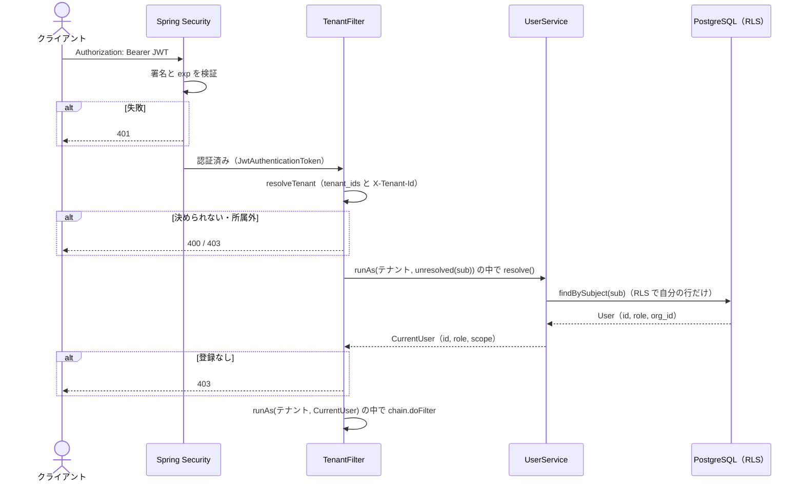

# テナントとユーザーの確定（JWT・TenantFilter・UserService）

RLS は、DB に届いた `app.*` の値を信じて行を絞ります。その値の出どころがこのページの処理で、ここが **信頼の起点** です。テナントやユーザーを取り違えると、RLS は正しく「間違った人」として動いてしまいます。

## 全体の流れ

## 1. JWT の検証（Spring Security）

`SecurityConfig` は、エラーディスパッチ以外のすべてのリクエストに認証を要求し、OAuth2 Resource Server の JWT 認証を使います。セッションは作らず（`STATELESS`）、Cookie を使わない Bearer トークンの API なので CSRF 対策は無効にしています。

`JwtDecoder` は、サンプル用に `app.jwt.secret` の HS256 共有鍵で署名を検証します。署名と有効期限（`exp`）はここで検証され、トークンがない・署名が不正・期限切れなら 401 です。本番では IdP の公開鍵で検証するので、この Bean を消して `spring.security.oauth2.resourceserver.jwt.issuer-uri` を設定するだけで切り替わります。

`TenantFilter` は `AuthorizationFilter` の **後ろ** に追加されているので、認証・認可が済んだリクエストだけがテナントの確定に進みます。

## 2. テナントを決める（TenantFilter#resolveTenant）

`TenantFilter` は `/api/` で始まるリクエストだけを対象にします。テナントの根拠は **署名検証済みの JWT のクレーム `tenant_ids`**（そのユーザーが所属するテナントの一覧）だけで、ヘッダ `X-Tenant-Id` は「所属テナントの中からどれを使うか」を選ぶためだけに使います。

| 状況 | 結果 |
|---|---|
| `tenant_ids` がない、配列でない、解釈できない要素を含む | 403 |
| ヘッダなし・所属が1社 | その1社 |
| ヘッダなし・所属が複数社 | 400（どれか決められない） |
| ヘッダが正の数値でない | 400 |
| ヘッダのテナントが `tenant_ids` に含まれない | 403（なりすましの試みとして WARN ログ） |
| ヘッダのテナントが `tenant_ids` に含まれる | そのテナント |

クレームの値は数値でも文字列でも受け付けますが、1つでも解釈できない要素があればクレーム全体を無効とします。所属していないテナントの指定は、監査用に `subject`・指定値・許可された一覧を WARN で記録します。

ヘッダを信用しない理由は、ヘッダはクライアントが自由に書き換えられるからです。テナントを JWT のクレームで縛っておけば、ヘッダを書き換えても所属していないテナントには入れません。

## 3. テナントの中の誰かを決める（TenantFilter#resolveUser → UserService#resolve）

JWT から分かるのは `sub`（IdP 上の誰か）だけです。ユーザー ID・ロール・見てよい部署は、テナントを確定したあとに DB から決めます。

1. `sub` が空なら 403
2. `TenantContext.runAs(テナント)` と `UserContext.runAs(CurrentUser.unresolved(sub))` の中で `CurrentUserResolver#resolve` を呼ぶ。実装は `UserService`
3. `UserService#resolve` は読み取り専用トランザクションで `UserMapper#findBySubject` を呼ぶ。この時点で DB に届いているのは `app.tenant_id` と `app.subject` だけで、`users_select` ポリシーは `subject` で自分の行を判定するので、引けるのはそのテナントの自分の行だけ
4. 見つかったら、`AccessScopeResolver` で見てよい部署を算出し、`CurrentUser(subject, id, role, scope)` を返す（[組織階層による見える範囲](../authorization/org-hierarchy-scope.md)）
5. 見つからなければ 403（そのテナントに登録がない。WARN ログ）

ロールを JWT に入れずに DB から取るので、ロールの変更はトークンの再発行を待たずに次のリクエストから反映されます。また、同じ人（同じ `sub`）でも、テナントごとに `users` の行とロールを持てます。デモデータの `taro` は、A商事では `GENERAL`、B工業では `ADMIN` です。

### CurrentUser の2つの状態

`CurrentUser` は「テナントの中の誰か」を表す record で、2つの状態しか取りません。

| 状態 | `subject` | `id` / `role` / `scope` | 作られる場所 |
|---|---|---|---|
| 未解決 | あり | すべて null | `CurrentUser.unresolved(sub)`。ユーザー解決の間だけ使う |
| 解決済み | あり | すべてあり | `UserService#resolve` |

コンストラクタは `subject` を必須とし、`id`・`role`・`scope` が「全部ある」か「全部ない」かのどちらかでなければ例外を投げます。サービス層は `UserContext.require()` を使うので、未解決のユーザーのまま業務処理が進むことはありません。

## 4. 後続を「そのテナントの、その人」として実行する

テナントとユーザーが決まったら、`TenantContext.runAs(テナント, () -> UserContext.runAs(user, () -> chain.doFilter(...)))` で後続のフィルタと Controller を実行します。後続のトランザクションでは、`TenantAwareTransactionManager` がこの値を DB に渡します（[DB へのコンテキスト受け渡し](../request-lifecycle/db-session-context.md)）。`chain.doFilter` が投げる `IOException` / `ServletException` は、ラムダの外へ運んでからそのまま再送出します。

拒否するときは、`application/problem+json` で `status`・`title`・`detail` を書いて返します。

## 確認しているテスト

`TenantFilterWebTest` が MockMvc で HTTP 経由の挙動を確かめています。トークンなし・別の鍵で署名したトークンの 401、ヘッダの有無と所属数による振り分け、なりすましの 403、`tenant_ids` なしの 403、数値でないヘッダの 400、登録のないユーザーの 403、`taro` のテナントごとのロール、`/api/me` の見てよい部署などです（[テスト：越境できないことの確認](../testing/rls-test-suite.md)）。
